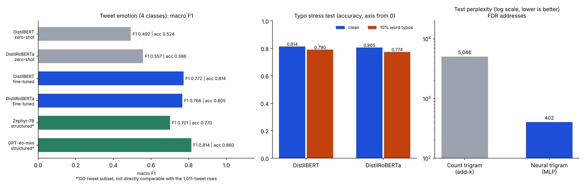
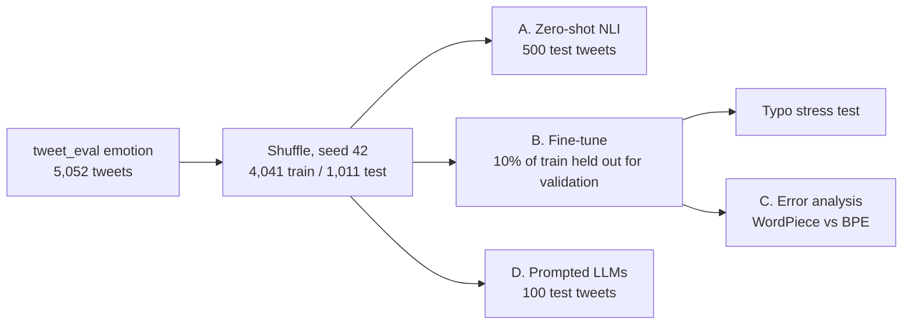

# Tweet Emotion Classification and N-gram Language Models

Two NLP experiments from one homework (DATA 266): **(1)** classifying tweet emotion with zero-shot transformers, fine-tuned transformers and prompted LLMs, and **(2)** language modelling on Franklin D. Roosevelt's State of the Union addresses with a count-based and a neural trigram model.

> The numbers below are transcribed from the saved outputs of the Colab notebook in [`notebooks/`](notebooks/). The experiments need a GPU and API access, so I did not re-run them for this repo. [`make_chart.py`](make_chart.py) redraws the chart from the CSVs in [`results/`](results/).

## 1. Tweet emotion (`cardiffnlp/tweet_eval`, `emotion`: anger, joy, optimism, sadness)

| Stage | Model | Eval size | Accuracy | Macro F1 |
|---|---|---|---|---|
| A. Zero-shot | DistilBERT (`typeform/distilbert-base-uncased-mnli`) | 500 | 0.524 | 0.492 |
| A. Zero-shot | DistilRoBERTa (cross-encoder NLI) | 500 | 0.586 | 0.557 |
| B. Fine-tuned | DistilBERT | 1,011 | **0.814** | **0.772** |
| B. Fine-tuned | DistilRoBERTa | 1,011 | 0.805 | 0.766 |
| B. Typo noise | DistilBERT | 1,011 | 0.790 | 0.746 |
| B. Typo noise | DistilRoBERTa | 1,011 | 0.774 | 0.731 |
| D. Minimal prompt | GPT-4o-mini | 100 | 0.83 | 0.697 |
| D. Structured prompt | GPT-4o-mini | 100 | 0.86 | 0.814 |
| D. Minimal prompt | Zephyr-7B-beta | 100 | 0.73 | 0.691 |
| D. Structured prompt | Zephyr-7B-beta | 100 | 0.77 | 0.701 |

What the results show:

- **Fine-tuning beats zero-shot by 22 to 29 points of accuracy** (0.586 to 0.805 for DistilRoBERTa, 0.524 to 0.814 for DistilBERT), though the zero-shot rows use different NLI checkpoints and a 500-tweet subset (see caveats).
- **Accuracy falls 2.4 points (DistilBERT) and 3.1 points (DistilRoBERTa)** when 10% of words longer than three characters get two adjacent letters swapped.
- **A structured prompt with label definitions helped both LLMs**, most visibly on macro F1 for GPT-4o-mini (0.697 to 0.814). Its accuracy moved from 0.83 to 0.86.
- **Optimism is the hard class.** It has only 82 test tweets, and its F1 is 0.62 (DistilBERT) and 0.61 (DistilRoBERTa), against 0.76 to 0.86 for the other classes.
- **Tokenizers behave differently on noisy text.** The error analysis shows WordPiece mapping an emoji to `[UNK]` while byte-level BPE keeps it as byte fragments, so some signal survives.

Fine-tuning settings: 20 epochs maximum, batch size 16, AdamW, learning rate 2e-5, weight decay 0.01, 10% warmup, early stopping with patience 3, best checkpoint chosen by validation macro F1.

## 2. N-gram language models on FDR's State of the Union addresses

Corpus: 12 addresses, 46,735 tokens, vocabulary 6,183. Trigrams are split chronologically 80/10/10 (37,386 / 4,673 / 4,674).

| Model | Train PPL | Val PPL | Test PPL |
|---|---|---|---|
| Count-based trigram, add-k (k = 0.5) | 1,834 | 5,304 | 5,046 |
| Neural trigram MLP (embedding 64, hidden 128, dropout 0.5; 1.21M parameters) | n/a | n/a | **402** |

The neural model stopped early at epoch 50 and its best epoch was 31, with a best validation loss of 6.313.

Four decoding strategies were compared from the seed "the people of": greedy and beam search (width 3) both fall into repetition loops, top-K (K = 5) wanders, and nucleus sampling (p = 0.9) was the most varied. On the count-based model, top-K and nucleus output is mostly rare-word noise, because add-k spreads probability mass across the whole vocabulary.

## Caveats

- **The dataset is smaller than the assignment's 12,000-sample target.** `tweet_eval` emotion has only 5,052 tweets, so the notebook used all of them (4,041 / 1,011).
- **Part A compares different models, not just different tokenizers.** DistilBERT used an MNLI-tuned checkpoint and DistilRoBERTa a cross-encoder NLI checkpoint, so the gap mixes tokenizer and NLI-training effects. It covers the first 500 test tweets.
- **Part D samples are tiny.** With 100 tweets, one tweet is one accuracy point, so the 0.83 vs 0.86 gap is three tweets. Only the structured-vs-minimal F1 gap for GPT-4o-mini is large enough to take seriously. Timings mix local GPU inference with API latency and are not comparable.
- **The typo result is a single random corruption of the test set**, with no repeats or confidence intervals.
- **Perplexities are only comparable within this corpus.** The count model uses one add-k value of 0.5 with a 6,183-word vocabulary, which is heavy smoothing. I did not see a sweep over k, so part of the 5,046 vs 402 gap may be smoothing rather than model class. The corpus is one president, so these figures say nothing about general English.

## Stack

`Python` `PyTorch` `Hugging Face Transformers` `Datasets` `scikit-learn` `OpenAI API` `Zephyr-7B` `matplotlib`

## Notebooks

| Notebook | Contents |
|---|---|
| [`notebooks/DATA266_HW1_tweet_emotion_and_ngram_LM.ipynb`](notebooks/DATA266_HW1_tweet_emotion_and_ngram_LM.ipynb) | Full Colab run with outputs: both parts, error analysis and decoding critique. Student ID and Colab account metadata removed. |
